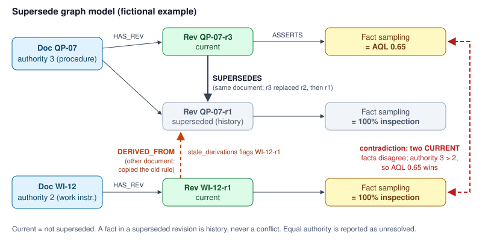

# Supersede

**Agent memory that knows which fact is currently in force, and why.**

Built for the Relate by Neo4j Hackathon on [Relate](https://relatedb.ai), the embedded graph database.

## Try it in 2 minutes

After the install in [Setup and run](#setup-and-run) (about 90 seconds, then everything below is
offline):

```bash
python examples/demo_session.py                  # a naive baseline vs Supersede, in a few seconds
python examples/ask.py "How long must retained samples be kept?"
python examples/ask.py "What sampling rule applied?" --as-of 2025-07-01
python examples/ask.py "Which form do inspectors fill in for final inspection results?"
```

What to look at: the first answer is **10 years from the customer requirement**, although a newer
shift note says 3 years (authority beats date, and the reason is shown). The second answers for a
past date. The third names the form but also flags that its source was written from a procedure
revision that has since been replaced (**stale**). A real Claude agent doing the same over MCP:
[docs/agent_transcript.md](docs/agent_transcript.md).

## Use case

Agents that remember facts from documents hit the same failure: a procedure gets revised, the old
revision is still in memory, and the agent happily quotes the stale one. Two documents disagree and
the agent picks whichever its retrieval returned first. Vector memory has no notion of *"this
replaced that"* or *"this source outranks that one"*.

**Who it is for:** quality and compliance teams, and the agents that work over their revised
procedures, customer requirements, work instructions and shift notes, where quoting a superseded
value, or picking the wrong one of two conflicting documents, has real consequences.

**Which relationships matter:** which revision replaced which (`SUPERSEDES`), which document a fact
comes from, and how much that document outranks another (authority).

## How it uses Relate

* **Mode:** persistent on-disk store, in **directory** mode (`--db path`; Relate keeps it as a
  directory). `:memory:` is used only by tests and one-off scripts.
* **Why this mode:** the revision history is the point of the project, and in-memory data
  disappears when the process stops. A directory store survives restarts, can be inspected, and a
  small one is committed in this repo (see [Where the data lives](#where-the-data-lives)).
* **What the graph models:**

```
(Doc {authority})-[:HAS_REV]->(Rev)-[:ASSERTS]->(Fact {subject, predicate, value})
(Rev)-[:SUPERSEDES]->(Rev)          // within one document: newer replaces older
(Rev)-[:DERIVED_FROM]->(Rev)        // across documents: written from that revision
(Topic {subject, predicate, description})   // plain-language description, searched by Relate's full-text index
```



  * **Current** means "not superseded". It is a graph pattern, not a date comparison.
  * A **contradiction** exists only between facts in *current* revisions. A fact from a superseded
    revision is history, not a conflict.
  * Contradictions are **resolved by the authority** of the owning document (customer requirement >
    controlled procedure > work instruction > shift note or email). If authority ties, Supersede
    says *unresolved* instead of guessing.
  * Every answer carries its **reason** and the **overruled** sources.
  * **Ask in plain language:** `ask()` searches the topic descriptions with Relate's full-text index
    (BM25), then lets the graph decide the value, so a question gets the answer in force with its
    reason, not the best-matching text.
  * **Time:** `answer(..., as_of=date)` answers for a past date. Effective dates are taken at face
    value and any missing, unreadable, future or out-of-order date is reported, never guessed.
  * **Lineage:** a revision can record which revision of another document it was written from.
    `stale_derivations` follows those links, directly or through a chain, and lists current
    revisions that rest on a source that has since been superseded, and what replaced it.

```
current_answer("final_inspection", "sampling")
-> {"status": "resolved", "value": "AQL 0.65", "source": "QP-07-r3",
    "reason": "QP-07 (authority 3) outranks the conflicting source(s)",
    "overruled": [{"fact": "F04", "value": "100% inspection", "rev": "WI-12-r1", ...}]}
```

Relate is an embedded graph database with Cypher, so the supersession chains, the "not superseded"
pattern, and the cross-document contradiction join are each a short Cypher query, running in the
agent's own process.

**Relate capabilities used:** the embedded Python DB-API (`relate.connect`, `$name` parameters,
commit, close); a persistent directory store, also opened `read_only=True`; `MERGE` upserts;
`NOT (...)` pattern predicates; unbounded variable-length paths (`[:SUPERSEDES*1..]`, `[:DERIVED_FROM*1..]`,
`*0..` for the cycle checks) with `length(p)`; multi-`MATCH` joins; `ORDER BY` and `count()`; a
**full-text index** (`CREATE FULLTEXT INDEX`) queried with `SEARCH ... SCORE AS`, which persists in
the directory store and works on a read-only open. **Not used:** vector search (it needs embeddings
you supply, and Relate does not compute them, so it would add a model dependency), Relate's own MCP
server, the CLI, Bolt or HTTP, WebAssembly. Supersede ships its own MCP server with domain tools
instead.

## Setup and run

Requires Python 3.10 or later. No network access is needed after `pip install`. CI runs the tests,
the eval, the demo and the ingestion on Linux, macOS and Windows with Python 3.10, 3.11, 3.12 and 3.13.

```bash
python -m venv .venv && . .venv/bin/activate   # Windows PowerShell: .venv\Scripts\Activate.ps1
pip install -e ".[dev]"

python examples/seed_demo.py demo.relate     # small fictional demo knowledge base
python -m pytest -q                          # 126 tests (125 without an API key: one live test is skipped)
python examples/mcp_smoke.py demo.relate     # spawns the MCP server and calls it as an agent would
python eval/run_eval.py                      # 19 questions: Supersede vs a naive baseline and two ablations
```

### A web page

`python web/app.py` serves a read-only page over the committed fictional store (standard library only,
no keys, no writes): type a question, optionally pick a date, see the value in force, the reason,
what it overruled, stale sources and date problems. It ships as a Docker image (`Dockerfile`); how to
host it on Hugging Face Spaces or elsewhere is in [docs/DEPLOY.md](docs/DEPLOY.md).

### A real agent

`python examples/agent_demo.py` lets a Claude model use the MCP server with no script: it picks the
tools itself. It needs `pip install -e ".[llm]"` and `ANTHROPIC_API_KEY`, and sends the questions
and tool results (fictional data) to the API. A recorded run is in
[docs/agent_transcript.md](docs/agent_transcript.md); it is verbatim, including one place where the
model misreads `current_revisions` in its last answer.

### Demo

A scripted agent session over a larger fictional corpus (16 documents, 26 revisions, 47 facts;
the cases are described in [examples/corpus/CASES.md](examples/corpus/CASES.md)). It starts the
MCP server over stdio, connects as an MCP client, and runs four steps: a naive baseline vs
`current_answer`, `find_contradictions`, an equal-authority conflict reported as `unresolved`,
and `revision_history`. It ends with the eval scores. Fully offline.

```bash
python examples/demo_session.py            # add --pause to slow it down for recording
```

Optional: `pip install -e ".[llm]"`, set `ANTHROPIC_API_KEY` in your environment, and add `--llm`
to have a model phrase the step-1 answer in one sentence from `current_answer`'s JSON. The key is
read from the environment only and is never stored.

### Use it from an MCP client

Tools: `ask` (plain language), `current_answer`, `answer_as_of`, `find_contradictions`,
`current_revisions`, `revision_history`, `stale_derivations`, `date_warnings`.

Every tool only reads, so the server opens an existing store **read-only**, and it refuses a
`--db` path that does not exist. MCP hosts start the server from their own working directory, so
use **absolute paths** for both the Python in this repo's `.venv` and the store.

```json
{
  "mcpServers": {
    "supersede": {
      "command": "/absolute/path/to/supersede/.venv/bin/python",
      "args": ["-m", "supersede.mcp_server",
               "--db", "/absolute/path/to/supersede/examples/store/supersede-demo.relate"]
    }
  }
}
```

On Windows the Python path is `C:\\path\\to\\supersede\\.venv\\Scripts\\python.exe`. After
`pip install -e .` no `PYTHONPATH` is needed.

### Load your own documents

Write one Markdown file per document revision: a small header, and facts marked inline in the
prose with `{{subject.predicate = value}}` (see [examples/documents](examples/documents/)).

```markdown
---
doc: QP-40
title: Packaging and labelling procedure
authority: 3
revision: 2
effective: 2025-10-01
supersedes: 1
derived_from: QP-07-r1   # optional: revision(s) of other documents it was written from
---
Finished castings are packed {{packaging.units_per_box = 24}} to a box.
```

```bash
python -m supersede.ingest examples/documents --db my-store.relate   # the path must not exist yet
```

This reads facts that an author has marked; it does **not** extract facts from unannotated text on
its own. Programmatic use: `supersede.ingest.ingest_directory(store, folder)`.

### Extract facts from unannotated text (optional)

For plain prose with no annotations, a language model can propose the facts, with guard rails:

* The model may only use keys from a **vocabulary** you provide
  ([examples/documents_raw/vocabulary.json](examples/documents_raw/vocabulary.json)).
* Every fact must carry a **verbatim quote** from the document, and the value must appear in that
  quote. Anything else is rejected and listed, and is never written.
* Nothing touches a store. It writes an annotated **review copy** of each document; you check it,
  then load it with `supersede.ingest` (which is deterministic).

```bash
pip install -e ".[llm]"            # the optional Anthropic SDK; set ANTHROPIC_API_KEY in your environment
python -m supersede.extract examples/documents_raw --vocabulary examples/documents_raw/vocabulary.json --out review
python -m supersede.ingest review --db extracted.relate
```

This sends the document text to the Anthropic API, so do not use it on confidential documents unless
that is acceptable; the default install stays offline. Each document must still carry the small
header (document id, authority, revision, dates).

Measured live with `python eval/run_extraction_eval.py` on 8 fictional documents with 18 gold facts
(written before any model was run; besides fixed prompt rules, the vocabulary is the only task guidance the model gets): the first run
scored precision 0.67 and recall 0.67, and every miss was a value format (`2.5 bar` instead of
`2.5`) that my vocabulary had not specified. After clarifying the value format in the vocabulary
(a change informed by that first run), three runs scored precision 1.00 and recall 0.94, 1.00 and
0.94; the one fact that varies is an ambiguous sentence the model sometimes declines to map. The
model never extracted a historical or rejected value and never invented a fact, and the guard rails
rejected nothing. This is a small, author-written set, so treat it as evidence that the approach
works, not as a benchmark.

It also works on **real text**: [examples/real](examples/real/) holds two sections of the US Federal
Acquisition Regulation at three dated versions each, from the public eCFR (public domain), in which
dollar thresholds really changed ($5.5M, $6M, $7.5M and $7M, $7.5M, $9M). On the first, blind run
the model got 13 of 15 gold facts (the two misses were `120 days or more` against `120 days`; no
wrong fact). After I clarified the value format in the vocabulary (informed by that run), three runs
got 15 of 15, and the graph built from the extracted facts gave the same answer as the gold graph for
every one of the 15 (key, date) pairs, so supersession and as-of answers over a real history hold.
It is only 6 documents on procurement compliance, not quality manufacturing.

## Where the data lives

A persistent store you can inspect is committed at
[`examples/store/supersede-demo.relate/`](examples/store/) (directory mode, built from the
fictional corpus: 16 documents, 26 revisions, 47 facts). Open it with
`relate.connect(path, read_only=True)` or point the MCP server at it;
[examples/store/README.md](examples/store/README.md) has the commands and how to regenerate it.
`demo.relate` from the setup commands is a separate local store and is not committed.

## Results

`python eval/run_eval.py` runs 19 questions over the fictional corpus: **Supersede 19/19**, a
newest-effective-date baseline 9/19, and two ablations that each keep one part of the graph
(following `SUPERSEDES` only 15/19, authority only 11/19). The cases are in
[examples/corpus/CASES.md](examples/corpus/CASES.md). The data is fictional and the cases were
designed, so this shows behavior, not performance on real documents, which are messier.

## Design notes

* **Thread affinity.** Relate connections are thread-affine (DB-API `threadsafety = 1`), and an MCP
  server calls tools from worker threads. `Store` runs all database work on one dedicated thread;
  a regression test covers it.
* **Stale facts.** An early version of the contradiction query compared facts across *all*
  revisions and flagged superseded ones. The current query excludes them, and a test pins that
  behavior.
* **Strict writes.** `Store` raises `ValueError` instead of silently doing nothing: unknown
  document or revision ids, a reused fact id (which would overwrite another revision's fact), a
  non-integer authority, and a `SUPERSEDES` link that would close a cycle.
* **A revision replaces the whole previous one.** Facts are not carried forward, so a fact a newer
  revision does not restate is no longer in force.

## Disclosures (per the contest rules)

* **Started:** 21 November 2026, inside the contest period. No pre-existing project is submitted.
* **Reused code:** none copied. The *concepts* (document authority hierarchy, `SUPERSEDES` chains,
  contradiction detection) come from the author's earlier GraphRAG work; this implementation was
  written from scratch for Relate.
* **Data:** all demo data is fictional and written for this repo. No client or third-party documents.
* **AI tools:** Claude (Anthropic), used through Claude Code, helped throughout: the code, tests,
  the fictional corpus and eval questions, the eval and baselines, the demo scripts and the screen
  capture of the demo, a repo audit, and the README, submission text and video script. The author
  directed the design and is responsible for the result. Separately, the optional `supersede.extract`
  tool and the demo's `--llm` flag call a Claude model at run time.
* **Third-party:** Relate (`relate-db` 1.2.0, Apache-2.0) and the MCP Python SDK. Dev only:
  pytest and PyYAML. Optional (the demo's `--llm` flag and `supersede.extract`): the Anthropic Python
  SDK and the Anthropic API, to which those two features send text; the default path is offline.

## License

MIT. See [LICENSE](LICENSE).
