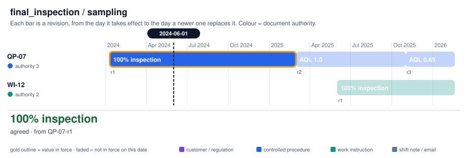
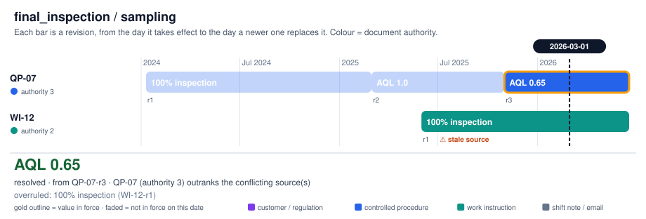
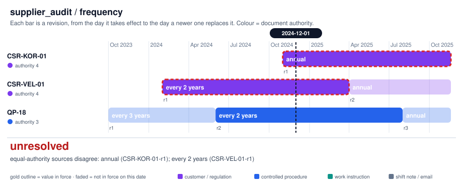
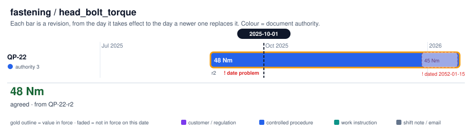

# Supersede

**Agent memory that knows which fact is currently in force, and why.**

Built for the Relate by Neo4j Hackathon on [Relate](https://relatedb.ai), the embedded graph database.

**Live demo:** https://supersede-demo.onrender.com (read-only, fictional data; a free instance, so the first visit after idle takes about a minute to wake).

```
Q: How long must retained samples be kept?
naive baseline (newest fact wins):  3 years    (a night-shift note)
Supersede:                          10 years   from the customer requirement, because it outranks the shift note
```

Supersede keeps documents, their revisions and their authority as a graph, so an agent gets the value that is
**in force**, with the reason, instead of the best-matching or newest text.


*The sampling rule at 2024-06-01, 2025-07-01 and 2026-03-01, looping, drawn from the real store: each bar is a revision,
colour is authority, the gold outline is the value in force. `python web/app.py` has a slider that moves the date
yourself. Short on time? Read the [judge guide](JUDGES.md): three commands and what each proves.*

## Try it in 2 minutes

After the install in [Setup and run](#setup-and-run) (about 90 seconds, then everything below is
offline):

```bash
python examples/demo_session.py                  # a naive baseline vs Supersede, in a few seconds
python examples/ask.py "How long must retained samples be kept?"
python examples/ask.py "What sampling rule applied?" --as-of 2025-07-01
python examples/ask.py "Which form do inspectors fill in for final inspection results?"
```

What to look at: the first answer is **10 years from the customer requirement**, although a newer
shift note says 3 years (authority beats date, and the reason is shown). The second answers for a
past date. The third names the form but also flags that its source was written from a procedure
revision that has since been replaced (**stale**). A real Claude agent doing the same over MCP:
[docs/agent_transcript.md](docs/agent_transcript.md).

## Watch the answer change over time

The same question at different dates (these pictures are generated from the committed store by `web/timeline.py`):

**Early 2024:** only revision 1 of the procedure exists.


**March 2026:** revision 3 of the procedure now says AQL 0.65; the work instruction is still in force but overruled.


**Equal authority:** two customer requirements disagree, so Supersede says `unresolved` instead of picking one.


**A mistyped date** (2052) is drawn and flagged, not trusted; the answer comes from the revision that is really in force.


## Use case

Agents that remember facts from documents hit the same failure: a procedure gets revised, the old
revision is still in memory, and the agent happily quotes the stale one. Two documents disagree and
the agent picks whichever its retrieval returned first. Vector memory has no notion of *"this
replaced that"* or *"this source outranks that one"*.

**Who it is for:** quality and compliance teams, and the agents that work over their revised
procedures, customer requirements, work instructions and shift notes, where quoting a superseded
value, or picking the wrong one of two conflicting documents, has real consequences.

**Which relationships matter:** which revision replaced which (`SUPERSEDES`), which document a fact
comes from, and how much that document outranks another (authority).

## How it uses Relate

* **Mode:** persistent on-disk store, in **directory** mode (`--db path`; Relate keeps it as a
  directory). `:memory:` is used only by tests and one-off scripts.
* **Why this mode:** the revision history is the point of the project, and in-memory data
  disappears when the process stops. A directory store survives restarts, can be inspected, and a
  small one is committed in this repo (see [Where the data lives](#where-the-data-lives)).
* **What the graph models:**

```
(Doc {authority})-[:HAS_REV]->(Rev)-[:ASSERTS]->(Fact {subject, predicate, value})
(Rev)-[:SUPERSEDES]->(Rev)          // within one document: newer replaces older
(Rev)-[:DERIVED_FROM]->(Rev)        // across documents: written from that revision
(Topic {subject, predicate, description, embedding})   // plain-language description, searched by Relate's full-text AND vector indexes
```


  * **Current** means "not superseded". It is a graph pattern, not a date comparison.
  * A **contradiction** exists only between facts in *current* revisions. A fact from a superseded
    revision is history, not a conflict.
  * Contradictions are **resolved by the authority** of the owning document (customer requirement >
    controlled procedure > work instruction > shift note or email). If authority ties, Supersede
    says *unresolved* instead of guessing.
  * Every answer carries its **reason** and the **overruled** sources.
  * **Ask in plain language:** `ask()` searches the topic descriptions with **hybrid retrieval**
    (Relate's full-text index and vector index, fused by reciprocal rank), then lets the graph decide the
    value, so a question gets the answer in force with its reason, not the best-matching text.
    The vectors come from a small built-in hashing embedder (no model, no key): it handles word forms and
    typos but not true synonyms. For synonyms there is an optional trained model, `pip install "supersede[embed]"`
    (fastembed, ONNX, no PyTorch): `Store(embedder=FastEmbedEmbedder())`, or try
    `python examples/ask.py "How many minutes until the coating has hardened?" --embedder model --retrieval vector`. `python eval/compare_retrieval.py` compares
    full-text, vector and hybrid (see [docs/EVIDENCE.md](docs/EVIDENCE.md)).
  * **Time:** `answer(..., as_of=date)` answers for a past date. Effective dates are taken at face
    value and any missing, unreadable, future or out-of-order date is reported, never guessed.
  * **Lineage:** a revision can record which revision of another document it was written from.
    `stale_derivations` follows those links, directly or through a chain, and lists current
    revisions that rest on a source that has since been superseded, and what replaced it.

```
current_answer("final_inspection", "sampling")
-> {"status": "resolved", "value": "AQL 0.65", "source": "QP-07-r3",
    "reason": "QP-07 (authority 3) outranks the conflicting source(s)",
    "overruled": [{"fact": "F04", "value": "100% inspection", "rev": "WI-12-r1", ...}]}
```

Relate is an embedded graph database with Cypher, so the supersession chains, the "not superseded"
pattern, and the cross-document contradiction join are each a short Cypher query, running in the
agent's own process.

**Relate capabilities used:** the embedded Python DB-API (`relate.connect`, `$name` parameters,
commit, close); a persistent directory store, also opened `read_only=True`; `MERGE` upserts;
`NOT (...)` pattern predicates; unbounded variable-length paths (`[:SUPERSEDES*1..]`, `[:DERIVED_FROM*1..]`,
`*0..` for the cycle checks) with `length(p)`; multi-`MATCH` joins; `ORDER BY` and `count()`; a
**full-text index** (`CREATE FULLTEXT INDEX`) and **vector index** (`CREATE VECTOR INDEX`, cosine) queried with
`SEARCH ... SCORE AS`, which persist in the directory store and work on a read-only open; the two result lists are
fused in Python by default; Relate's own `COMBINE` hybrid is a preview feature and is available as an opt-in
(`Store(combine=True)`, `ask(retrieval="combine")`), measured in [docs/EVIDENCE.md](docs/EVIDENCE.md). Relate does not compute
embeddings, so Supersede supplies them. **Not used:** Relate's own MCP server, the CLI, Bolt or HTTP, WebAssembly. Supersede ships its own MCP server with domain tools
instead.

## Setup and run

Requires Python 3.10 or later. No network access is needed after `pip install`. CI runs the tests,
the eval, the demo and the ingestion on Linux, macOS and Windows with Python 3.10, 3.11, 3.12 and 3.13.

```bash
python -m venv .venv && . .venv/bin/activate   # Windows PowerShell: .venv\Scripts\Activate.ps1
pip install -e ".[dev]"

python examples/seed_demo.py demo.relate     # small fictional demo knowledge base
python -m pytest -q                          # 180 tests; 176 run on a plain install (the live-API test and 3 optional-model tests are skipped)
python examples/mcp_smoke.py demo.relate     # spawns the MCP server and calls it as an agent would
python eval/run_eval.py                      # 19 questions: Supersede vs a naive baseline and two ablations
```

### Demo, web page and a real agent

* `python examples/demo_session.py` runs a scripted agent session over the fictional corpus (16 documents, 26
  revisions, 47 facts; cases in [examples/corpus/CASES.md](examples/corpus/CASES.md)): a naive baseline against
  `current_answer`, `find_contradictions`, an equal-authority conflict reported as `unresolved`, and
  `revision_history`. Offline; add `--pause` to slow it down, or `--llm` (needs the `llm` extra and
  `ANTHROPIC_API_KEY`) to have a model phrase the first answer in one sentence from the tool's JSON.
* `python web/app.py` serves a read-only page over the committed store (standard library only, no keys, no writes):
  ask a question, or pick one and **drag the date slider** to watch the timeline and the answer change. It ships as a
  Docker image; it is live at https://supersede-demo.onrender.com, and hosting it is in [docs/DEPLOY.md](docs/DEPLOY.md).
* `python examples/agent_demo.py` lets a Claude model use the MCP server with no script (needs
  `pip install -e ".[llm]"` and `ANTHROPIC_API_KEY`; it sends the questions and fictional tool results to the API).
  A verbatim recorded run is in [docs/agent_transcript.md](docs/agent_transcript.md), including one place where the
  model misreads a tool result.

### Use it from an MCP client

Tools: `ask` (plain language), `current_answer`, `answer_as_of`, `find_contradictions`,
`current_revisions`, `revision_history`, `stale_derivations`, `date_warnings`.

Every tool only reads, so the server opens an existing store **read-only**, and it refuses a
`--db` path that does not exist. MCP hosts start the server from their own working directory, so
use **absolute paths** for both the Python in this repo's `.venv` and the store.

```json
{
  "mcpServers": {
    "supersede": {
      "command": "/absolute/path/to/supersede/.venv/bin/python",
      "args": ["-m", "supersede.mcp_server",
               "--db", "/absolute/path/to/supersede/examples/store/supersede-demo.relate"]
    }
  }
}
```

On Windows the Python path is `C:\\path\\to\\supersede\\.venv\\Scripts\\python.exe`. After
`pip install -e .` no `PYTHONPATH` is needed.

### Load your own documents

Write one Markdown file per document revision: a small header, and facts marked inline in the
prose with `{{subject.predicate = value}}` (see [examples/documents](examples/documents/)).

```markdown
---
doc: QP-40
title: Packaging and labelling procedure
authority: 3
revision: 2
effective: 2025-10-01
supersedes: 1
derived_from: QP-07-r1   # optional: revision(s) of other documents it was written from
---
Finished castings are packed {{packaging.units_per_box = 24}} to a box.
```

```bash
python -m supersede.ingest examples/documents --db my-store.relate   # the path must not exist yet
```

This reads facts that an author has marked; it does **not** extract facts from unannotated text on
its own. Programmatic use: `supersede.ingest.ingest_directory(store, folder)`.

### Extract facts from unannotated text (optional)

For plain prose with no annotations, a language model can propose the facts, with guard rails:

* The model may only use keys from a **vocabulary** you provide
  ([examples/documents_raw/vocabulary.json](examples/documents_raw/vocabulary.json)).
* Every fact must carry a **verbatim quote** from the document, and the value must appear in that
  quote. Anything else is rejected and listed, and is never written.
* Nothing touches a store. It writes an annotated **review copy** of each document; you check it,
  then load it with `supersede.ingest` (which is deterministic).

```bash
pip install -e ".[llm]"            # the optional Anthropic SDK; set ANTHROPIC_API_KEY in your environment
python -m supersede.extract examples/documents_raw --vocabulary examples/documents_raw/vocabulary.json --out review
python -m supersede.ingest review --db extracted.relate
```

This sends the document text to the Anthropic API, so do not use it on confidential documents unless
that is acceptable; the default install stays offline. Each document must still carry the small
header (document id, authority, revision, dates).

Measured live, on fictional prose and on **real text**: US federal regulations from the public eCFR, including
FDA's device quality regulation (21 CFR Part 820) before and after its 2026 rewrite, and an FDA guidance that still
cites a regulation section removed in 2026. The model never invented a fact (the guard rails reject anything without a
verbatim quote), and on the real text three informed runs scored 27 of 29 gold facts; the first, blind run on the
newest keys scored 24 of 27. The numbers, the blind-versus-informed runs and their limits are in
[docs/EVIDENCE.md](docs/EVIDENCE.md); the real documents and their provenance are in
[examples/real](examples/real/).

## Where the data lives

A persistent store you can inspect is committed at
[`examples/store/supersede-demo.relate/`](examples/store/) (directory mode, built from the
fictional corpus: 16 documents, 26 revisions, 47 facts). Open it with
`relate.connect(path, read_only=True)` or point the MCP server at it;
[examples/store/README.md](examples/store/README.md) has the commands and how to regenerate it.
`demo.relate` from the setup commands is a separate local store and is not committed.

## Results

`python eval/run_eval.py` is deterministic and offline:

| Test | Supersede | Baseline |
|---|---|---|
| 19 revision questions (fictional corpus, designed cases) | **19/19** | 9/19 (newest date wins); ablations 15/19 (follow `SUPERSEDES` only), 11/19 (authority only) |
| 23 plain-language questions, correct end to end | **23/23** | 13/23 (same search, newest date wins) |
| 13 "what was in force on this date" questions | **13/13** | 11/13 (newest fact before the date) |
| 3 cross-document lineage checks | **3/3** | n/a (the baselines keep no derivation structure) |

These are demonstrations of behavior on cases I designed, and a few numbers come from a run after a fix informed by
an earlier run. [docs/EVIDENCE.md](docs/EVIDENCE.md) lists every measurement with its blind result and its limits.

## Limits

* **Mostly fictional data.** The real-text set is 16 documents in 7 chains that I chose, and its hierarchy is a
  regulation over guidance, not a plant's own tiers. Company documents, shift notes and emails are untested on real data.
* **Exact-string values:** `100%` and `100% inspection`, or `2 years` and `two years`, count as different values.
* **A revision replaces the whole previous one:** a requirement it stops stating is no longer in force.
* **Authority is one integer per document,** and dates are taken at face value (bad dates are reported, not repaired).
* **Extraction** needs a vocabulary and a document header, is not deterministic, and sends text to an API.

## Design notes

* **Thread affinity.** Relate connections are thread-affine (DB-API `threadsafety = 1`), and an MCP
  server calls tools from worker threads. `Store` runs all database work on one dedicated thread;
  a regression test covers it.
* **Stale facts.** An early version of the contradiction query compared facts across *all*
  revisions and flagged superseded ones. The current query excludes them, and a test pins that
  behavior.
* **Strict writes.** `Store` raises `ValueError` instead of silently doing nothing: unknown
  document or revision ids, a reused fact id (which would overwrite another revision's fact), a
  non-integer authority, and a `SUPERSEDES` link that would close a cycle.
* **A revision replaces the whole previous one.** Facts are not carried forward, so a fact a newer
  revision does not restate is no longer in force.

## Disclosures (per the contest rules)

* **Started:** 21 November 2026, inside the contest period. No pre-existing project is submitted.
* **Reused code:** none copied. The *concepts* (document authority hierarchy, `SUPERSEDES` chains,
  contradiction detection) come from the author's earlier GraphRAG work; this implementation was
  written from scratch for Relate.
* **Data:** the corpus and demo data are fictional and written for this repo. `examples/real/` contains text of US
  federal regulations from the eCFR and an excerpt of one FDA guidance document: works of the US government in the
  public domain, each file stating its source and version date. No client documents, and no copyrighted third-party
  text (ISO 13485, which the 2026 regulation incorporates by reference, is not included).
* **AI tools:** Claude (Anthropic), used through Claude Code, helped throughout: the code, tests,
  the fictional corpus and eval questions, the eval and baselines, the demo scripts and the screen
  capture of the demo, a repo audit, and the README, submission text and video script. The author
  directed the design and is responsible for the result. Separately, the optional `supersede.extract`
  tool and the demo's `--llm` flag call a Claude model at run time.
* **Third-party:** Relate (`relate-db` 1.2.0, Apache-2.0) and the MCP Python SDK. Dev only:
  pytest and PyYAML. Optional (the demo's `--llm` flag and `supersede.extract`): the Anthropic Python
  SDK and the Anthropic API, to which those two features send text; the default path is offline.

## License

MIT. See [LICENSE](LICENSE).
